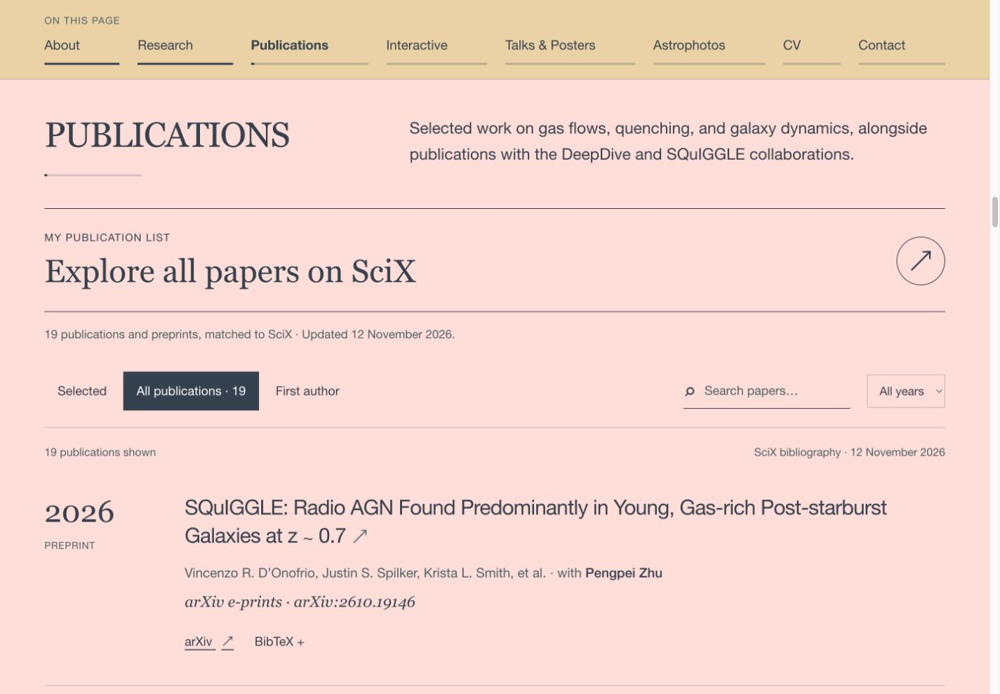

# Review copy · 12 November 2026

**Open the site:** double-click `Preview.command` on macOS. The supplied `out/` directory is a ready-built static website. Python 3 is needed by the launcher; Node.js 24 is needed only for editing/building or the alternative `npm run preview` command.

**GitHub status:** a local Git repository on `main` has been prepared. No GitHub repository, GitHub remote, push or Pages publication has been made. The included workflow is manual and awaits the owner's review. The existing private Sites website has received the same 19-paper bibliography update independently.

## Changes included

- All 19 records from the current SciX search, including Leviathan and SQuIGGLE radio AGN.
- Full BibTeX entries for the additions, an updated bibliography download, automatic counts and year filters, and SciX ordering in the All view.
- The complete current website, including the homepage email/CV/Contact links, branding, photos, scientific figure, talks/posters section and both full interactive labs.
- A portable static build, with asset paths that work for both a domain root and a GitHub project path.
- `AGENT.md`, setup/deployment instructions, source credits, a publication matching record and asset checksums.

## Validation performed

| Check | Result |
| --- | --- |
| Live SciX search | 19 results, all matched one-to-one to the website list |
| New metadata | Titles, authorship and preprint status checked against SciX and arXiv |
| Bibliography | 19 unique records; download matches the data source |
| TypeScript | Passed |
| Static export at `/` | Passed; all 22 homepage file references resolve |
| Static export at `/pengpei-astronomy/` | Passed; prefixed asset/download/lab URLs resolve |
| Static HTTP asset check | All 15 public files returned identical bytes under the project path |
| Publication controls | All = 19, First author = 2, Leviathan search = 1, year 2022 = 1 |
| UVJ preview | Blue preset changes U−V/V−J from 1.57/0.82 to 0.48/−0.01 |
| SFH preview | Two episodes displays both burst components |
| Photo viewer | Opens and closes successfully |
| Responsive checks | Desktop and 390 px viewport; no page overflow or broken loaded images |
| Browser console | No errors in the checked static-site interactions |
| CV and full labs | Exported bytes match their approved source assets |
| Review launcher | Shell and embedded Python syntax checked |

Build environment: Node.js 24.22.1, npm 11.21.2, Next.js 16.3.4. Both builds use the pinned dependencies. The actual GitHub Actions deployment has not run because nothing has been uploaded to GitHub.

The CV PDF remains the original four-page, 9 November 2026 version, with 17 papers. Presentation media, metallicity and visitor-map placeholders remain intentional. The local review package includes the built website; generated output is ignored by Git and rebuilt by the future Pages workflow.

