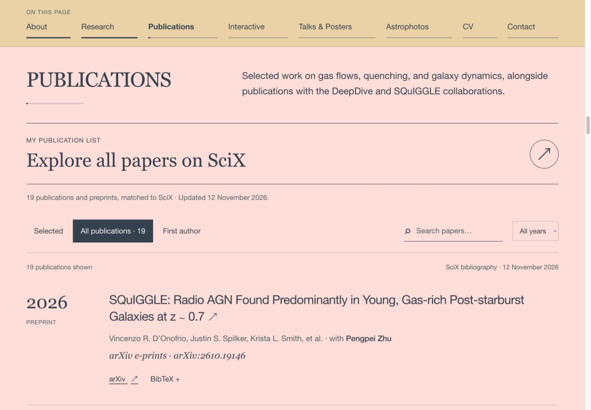

# Updates

Record future feature, content, design and maintenance changes here, newest first. Include the date, what changed, validation, and any relevant deployment status.

## 2026-11-12 · Public website on GitHub Pages

- The owner approved making the repository public and publishing the website through GitHub Pages.
- The publishing workflow builds the reviewed source on `main`, verifies content and types, and exports the site with the `/pengpei-astronomy/` prefix.
- Updated the maintenance guide and README with the public website address and the manual publishing procedure. The separate Sites-hosted copy keeps its existing private audience.
- Publication and live verification are in progress; the completion record will be added here after verification.

## 2026-11-12 · Private GitHub repository and surname identity

- Merged the maintenance notes into one `AGENTS.md` and removed the duplicate `AGENT.md`.
- Renamed `REVIEW.md` to `UPDATES.md` and established this file as the ongoing changelog.
- Replaced the star mark and browser icon with the surname 朱 in documented 小篆 (Shuowen seal script). The logo uses a terracotta seal field and cream lettering, and stays visible on small screens.
- The owner approved uploading the complete source to a private GitHub repository. Public GitHub Pages hosting is a separate step.
- Repository: [PengpeiZhu/pengpei-astronomy](https://github.com/PengpeiZhu/pengpei-astronomy), created as private with GitHub Pages disabled.
- Validation: content and asset checks passed (19 publications and 16 runtime assets); TypeScript passed; the static build passed with all 23 local file references resolving. The logo and header were checked at 1440 px, 390 px and 320 px, with no page overflow. The mobile menu opened and closed successfully.
- The existing owner-private Sites website was updated successfully from source commit `d71a9f056ccd015546af12e738a35f546583b761`, with its audience unchanged.

## 2026-11-12 · Initial GitHub review edition

**Open the site:** double-click `Preview.command` on macOS. The supplied `out/` directory is a ready-built static website. Python 3 is needed by the launcher; Node.js 24 is needed only for editing/building or the alternative `npm run preview` command.

**Status at this initial review:** a local Git repository on `main` was prepared before upload approval. The existing private Sites website received the same 19-paper bibliography update independently. The GitHub workflow was supplied for a future, separate hosting step.

### Changes included

- All 19 records from the current SciX search, including Leviathan and SQuIGGLE radio AGN.
- Full BibTeX entries for the additions, an updated bibliography download, automatic counts and year filters, and SciX ordering in the All view.
- The complete current website, including the homepage email/CV/Contact links, branding, photos, scientific figure, talks/posters section and both full interactive labs.
- A portable static build, with asset paths that work for both a domain root and a GitHub project path.
- Maintenance notes, setup/deployment instructions, source credits, a publication matching record and asset checksums.

### Validation performed

| Check | Result |
| --- | --- |
| Live SciX search | 19 results, all matched one-to-one to the website list |
| New metadata | Titles, authorship and preprint status checked against SciX and arXiv |
| Bibliography | 19 unique records; download matches the data source |
| TypeScript | Passed |
| Static export at `/` | Passed; all 22 homepage file references resolve |
| Static export at `/pengpei-astronomy/` | Passed; prefixed asset/download/lab URLs resolve |
| Static HTTP asset check | All 15 public files returned identical bytes under the project path |
| Publication controls | All = 19, First author = 2, Leviathan search = 1, year 2022 = 1 |
| UVJ preview | Blue preset changes U−V/V−J from 1.57/0.82 to 0.48/−0.01 |
| SFH preview | Two episodes displays both burst components |
| Photo viewer | Opens and closes successfully |
| Responsive checks | Desktop and 390 px viewport; no page overflow or broken loaded images |
| Browser console | No errors in the checked static-site interactions |
| CV and full labs | Exported bytes match their approved source assets |
| Review launcher | Shell and embedded Python syntax checked |

Build environment: Node.js 24.22.1, npm 11.21.2, Next.js 16.3.4. Both builds use the pinned dependencies. No GitHub Actions deployment was run as part of this initial review.

The CV PDF remains the original four-page, 9 November 2026 version, with 17 papers. Presentation media, metallicity and visitor-map placeholders remain intentional. The local review package includes the built website; generated output is ignored by Git and rebuilt by the future Pages workflow.

